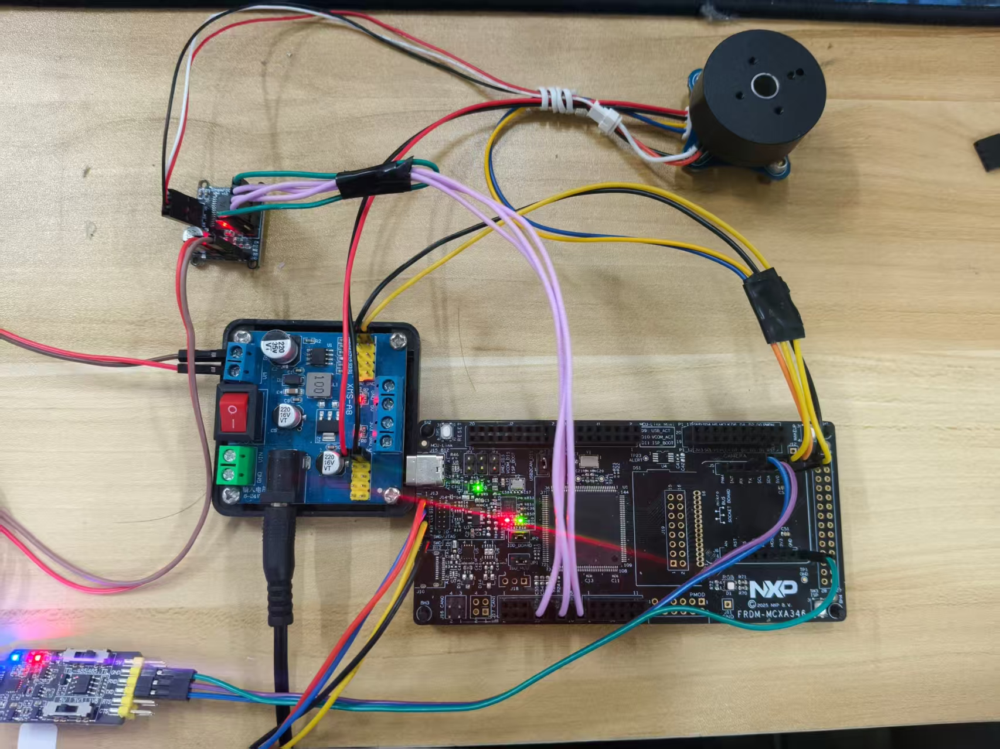
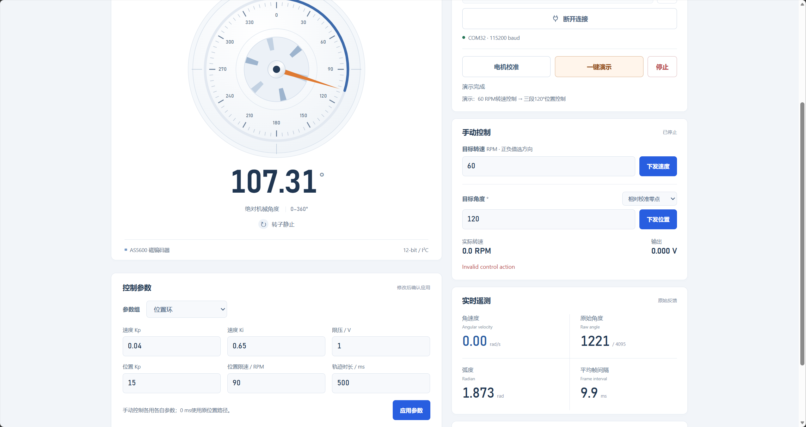

# 【2026嵌入式大赛】轻量神经网络增强的智能无刷电机控制器（RT-Thread + NXP MCXA346）

## 项目介绍

我用NXP FRDM-MCXA346开发板和RT-Thread做了一个无刷电机控制器。目前可以设置电机转速、切换转动方向，也可以让电机转到指定位置，运行状态通过网页仪表显示。

这个项目里，我主要尝试的是给传统FOC控制加一个小型神经网络。先把速度环和位置环做好，再用实际运行数据训练补偿模型，让网络在原有控制输出上补一点电压，改善低速运行时的速度波动。网络已经放到MCU上运行，在已完成的低速对照测试中，加入NN后，稳态尾段的速度误差均值降低了约4.26%。

硬件用的是2804无刷电机、AS5600磁编码器和SimpleFOC Mini驱动板，电源为12 V。AS5600通过I²C读取角度，MCXA346根据角度估算转速，再输出三路PWM驱动电机，采用电压模式FOC。

  

<em>图1　电机与控制器实物连接</em>

## 神经网络怎么参与控制

基础速度控制采用前馈加PI，神经网络负责计算额外的电压补偿量。补偿可以单独开关，方便用相同的电机和参数比较补偿前后的表现。

动态补偿网络只有3个输入、8个隐藏单元和1个输出，输入是目标转速、实际转速，以及两者方向是否相反。训练在电脑上完成，权重导出后由MCU中的C代码直接计算，固件不需要额外引入推理框架。电机闭环和网络计算都在板上完成，不依赖电脑实时下发控制量。

调试时也可以只计算网络输出、暂不施加补偿，先核对电脑与MCU的计算结果，再做电机运行对照。采集数据、模型权重和分析脚本都保留在项目中。

## 实际跑出来的效果

在±15 RPM范围内，测试了10种启转和连续速度切换。三组配置各重复三轮，共完成90段实板测试。加入动态NN后，相对相同PI与静态补偿基线，得到以下结果：

| 速度误差指标 | 基础控制 | 加入NN |
|---|---:|---:|
| 稳态尾段100 ms窗口RMSE | 2.187 RPM | 2.094 RPM，降低约4.26% |
| 整段RMSE | 3.327 RPM | 3.291 RPM，降低约1.07% |

这里的数值是各切换三轮测试的均值，再对10种切换等权平均。NN带来的改善主要体现在低速稳态段。

传统控制部分也做过单独优化。给P项目标加入25 ms平滑后，在另外60段实板测试中，整段速度误差均值降低约5.83%，首秒误差降低约11.77%。这部分与NN的结果分别统计。

## RT-Thread和上位机

RT-Thread下，控制线程按2 ms周期读取编码器、计算控制量并更新PWM。串口线程单独处理命令和遥测，接收中断配合环形缓冲接收数据，线程之间通过互斥量同步状态。

电脑通过外置USB串口模块连接开发板。网页可以选择串口、校准电机，查看连续旋转仪表、机械角度、角速度和通信状态，也提供一键演示与停止按钮。演示先运行速度环，再依次下发三个相差120°的位置目标。控制参数仍可通过串口CLI调整。页面显示与板上的闭环控制分开，网页刷新不会决定电机的控制周期。

  

<em>图2　网页上位机控制与监测界面</em>

项目已完成速度控制、位置控制、串口工具和网页监测，轻量NN已在MCU上运行并参与速度补偿。
